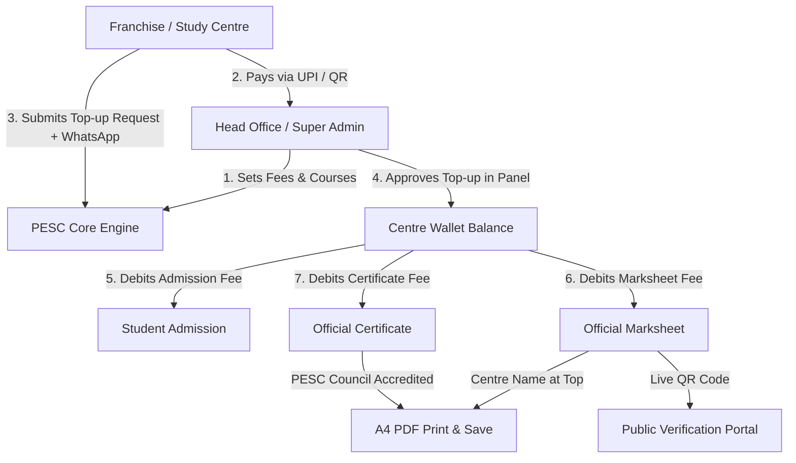

# Product Requirement Document (PRD)
## PESC Franchise & Institute Monetization Platform

### Project Overview & Problem Statement
The client operates the **Purvanchal Education and Skill Council (PESC)**, issuing franchises to vocational, computer, and skill training institutes across India. 

**Client's Core Business Objective:**
1. **Franchise Onboarding:** Sell franchises/centre affiliations to institute directors.
2. **Curriculum & Courses:** Provide standardized course catalogs (DCA, ADCA, PGDCA, CCC, Tally, Yoga, etc.) to affiliated centres.
3. **Monetization Engines (Per-Transaction Revenue):**
   - **Admission Form Fee:** Debited per student enrolled by the centre.
   - **Marksheet Fee:** Debited per marksheet issued to a student.
   - **Certificate Fee:** Debited per course completion certificate issued.
4. **Offline Wallet Top-Up via WhatsApp & Admin Approval:**
   - In the real-world Indian institute model, centres pay Head Office via UPI / QR / Bank Transfer / Cash.
   - Centre requests top-up in their portal with payment reference/UTR.
   - Centre sends a pre-filled WhatsApp message to the Head Office requesting approval.
   - Head Office opens the Admin Panel, verifies payment, and approves the top-up with 1 click.
   - Wallet balance is instantly credited and used by the centre for Admissions, Marksheets, and Certificates.
5. **Marksheet Design (Client's Primary Reason for Rejection):**
   - **Mandatory Requirement:** The top header of the marksheet **must prominently display ONLY the Centre / Institute Name** (as the authorized study centre), so the centre feels ownership and pride.
   - The design must look top-tier, government/council grade, anti-counterfeit with security borders, student photo, verified QR code, structured marks breakdown, and seamless single-page A4 PDF print/save.

---

## 1. System Architecture & User Roles

---

## 2. Core Functional Specifications

### Phase 1: Wallet Top-Up & Approval Workflow (WhatsApp-Integrated)

#### 1.1 Study Centre Experience (Centre Portal)
* **Wallet Balance Widget:** Prominently visible in the top navbar and dashboard:
  * Current Balance (`₹ X,XXX`)
  * Low balance warning when balance is below minimum threshold
  * Direct button: **"➕ Add Balance / Top-Up"**
* **Top-Up Request Modal:**
  * **Quick Amount Selector:** ₹500, ₹1,000, ₹2,000, ₹5,000, ₹10,000, or Custom Amount.
  * **Head Office Payment Details:** Shows Head Office UPI ID, official QR code image, and Bank Account details.
  * **Payment Submission Form:**
    * Amount (INR)
    * Payment Mode: UPI (GooglePay / PhonePe / Paytm / BHIM), IMPS / NEFT / Net Banking, or Cash.
    * Transaction Ref / UTR Number (mandatory).
    * Payment Date & optional note.
  * **1-Click WhatsApp Trigger:**
    * On submission, request is saved as `status: 'pending'`.
    * Immediately opens or provides a button: **"📱 Notify Head Office on WhatsApp"**.
    * Pre-filled text:
      > *"Namaste Head Office, I have transferred ₹[Amount] for Wallet Top-up via [Mode] (UTR: [UTR]). Centre: [Centre Name] (Code: [Centre Code]). Please approve my request in the admin panel. Thank you!"*
* **Top-up History & Status:**
  * Real-time list of past requests: Date, Amount, UTR, Status (`Pending ⏳`, `Approved ✅`, `Rejected ❌`), and Admin remarks.

#### 1.2 Head Office Experience (Super Admin Panel)
* **Pending Requests Notification Badge:**
  * Shows count of pending wallet top-up requests in the sidebar/topbar.
* **Top-Up Approval Management Screen:**
  * Table showing:
    * Request ID & Timestamp
    * Centre Name & Centre Code
    * Requested Amount (INR)
    * Payment Mode & UTR / Reference Number
    * Current Centre Wallet Balance
  * **Actions:**
    * **"✅ Approve & Credit"**: 1-click execution that:
      * Credits `amount_paise` to `wallets` table.
      * Inserts record into `wallet_transactions` ledger with reference `topup:<id>` and note `"Approved by Head Office - UTR: <utr>"`.
      * Updates top-up request status to `Approved`.
    * **"❌ Reject"**: Prompts for reason (e.g., "UTR not matched in bank statement") and marks request `Rejected`.
* **Complete Financial Ledger & Fee Configuration:**
  * Fee settings for Head Office:
    * Student Admission Fee: editable (default: ₹35)
    * Marksheet Issue Fee: editable (default: ₹150)
    * Certificate Issue Fee: editable (default: ₹200)

---

### Phase 2: Per-Action Fee Deduction Engine

| Action | Fee Trigger | Wallet Check | Behavior on Low Balance | Refund Rule |
| :--- | :--- | :--- | :--- | :--- |
| **Student Admission** | Submitting new student registration / admission form | `balance >= admission_fee` | Blocks form with modal: *"Insufficient balance. Required ₹35, available ₹X. Please top-up."* | Non-refundable once enrolled |
| **Marksheet Generation** | Submitting examination marksheet | `balance >= marksheet_fee` | Blocks submission with top-up alert | Refunded automatically if Head Office rejects marksheet |
| **Certificate Request** | Submitting course certificate request | `balance >= certificate_fee` | Blocks request with top-up alert | Refunded automatically if Head Office rejects certificate |

---

### Phase 3: Marksheet Redesign (Centre Name on Top)

#### 3.1 Header Hierarchy (Client's Mandatory Requirement)
1. **Topmost Section (Header):**
   * **Centre / Institute Name ONLY:** Big, bold, premium Devanagari Hindi + English typography (e.g., `ARYAVART COMPUTER SAKSHARTA MISSION`).
   * Subtext: Accredited Study Centre Code (`PESCnnnnn`), Campus Address, City, State, and Helpline Number.
   * Centre Logo / Emblem on the left.
2. **Sub-Header (Accreditation Body):**
   * Clear, elegant accreditation line:
     * *"Approved, Affiliated & Evaluated under the Aegis of:"*
     * **PURVANCHAL EDUCATION AND SKILL COUNCIL (PESC)**
     * Regd. Under Indian Trust Act, NITI Aayog (NGO Darpan), Govt. of India | ISO 9001:2015 Certified.
3. **Document Title Banner:**
   * **ANNUAL / SEMESTER STATEMENT OF MARKS** (with Examination Session, e.g., 2025-26).

#### 3.2 Candidate & Course Information Matrix
* Candidate Name, Father's Name, Mother's Name
* Enrollment / Student Registration No.
* Roll Number
* Course Name & Course Code
* Duration (e.g., 1 Year / 6 Months)
* Centre Name & Centre Code
* Candidate Passport Photo with official watermark

#### 3.3 Marks Table & Evaluation Format
* Standard multi-column table:
  * Paper Code
  * Subject / Module Name
  * Theory: Max Marks | Pass Marks | Marks Obtained
  * Practical / Lab: Max Marks | Pass Marks | Marks Obtained
  * Total Marks & Subject Result (PASS / FAIL)
* Summary Row: Grand Total, Maximum Marks, Percentage (%), Overall Grade (A+, A, B, C, D), and Result Division.

#### 3.4 Security & Authentication Elements
* Anti-counterfeit guilloche double border (Navy Blue `#072a60` & Royal Gold `#d4af37`).
* Council Watermark logo in center.
* **Unguessable QR Code:** Scannable from any smartphone, linking directly to `https://pescouncil.in/verify/marksheet/<token>`.
* **Signatures:**
  * Left: Centre Superintendent / Director (Authorized Study Centre).
  * Right: Controller of Examinations (PESC National Board).
  * Central Official Gold Stamp / Seal.

#### 3.5 Single-Page A4 Print & PDF Export
* Clean CSS `@media print` rules ensuring the document fits **exactly on 1 single A4 portrait page** (no spillover onto page 2).
* Native backend PDF generation (`/api/marksheets/:id/pdf`) using PDFKit, styled to match the exact same layout.

---

## 4. Implementation Step-by-Step Plan

1. **Database & Backend APIs (`src/db.js`, `src/routes/centre.js`, `src/routes/admin.js`):**
   - Add `wallet_topup_requests` schema.
   - Endpoint `POST /api/centre/wallet/request-topup` (validates amount, UTR, creates pending request, returns formatted WhatsApp deep-link).
   - Endpoint `GET /api/centre/wallet/requests` (returns centre's top-up history).
   - Endpoint `GET /api/admin/wallet/requests` (returns pending & historical requests).
   - Endpoint `POST /api/admin/wallet/requests/:id/approve` (credits wallet, records transaction, updates status).
   - Endpoint `POST /api/admin/wallet/requests/:id/reject` (marks rejected with reason).

2. **Frontend Centre Portal (`public/portal.html`, `public/js/centre.js`):**
   - Add modern "Top-Up Wallet" modal with Quick amounts, Head Office QR & UPI, UTR input, and automatic "Send on WhatsApp" button.
   - Display active top-up status table.
   - Add friendly insufficient balance alert with 1-click top-up trigger on Admission and Marksheet screens.

3. **Frontend Admin Panel (`public/admin.html`, `public/js/admin.js`):**
   - Add dedicated "Pending Wallet Approvals" badge and management tab.
   - 1-click "Approve" button with immediate UI update and ledger sync.

4. **Marksheet Redesign (`public/js/centre.js`, `public/js/student.js`, `public/verify.html`, `src/routes/marksheets.js`):**
   - Put **Centre Name at the very top** in prominent display styling.
   - Refactor HTML marksheet template with royal security borders, student photo, clean marks table, signatures, and QR code.
   - Calibrate A4 print CSS (`@media print`) and PDFKit generation so it fits perfectly on 1 page without extra white space or second page.

5. **End-to-End Testing & Verification:**
   - Test top-up submission -> WhatsApp link generation -> Admin approval -> Wallet balance update.
   - Test student admission fee debit -> Marksheet fee debit.
   - Test Marksheet view, print, and PDF generation with Centre Name on top.
   - Test QR code verification.
