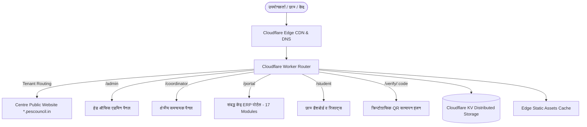
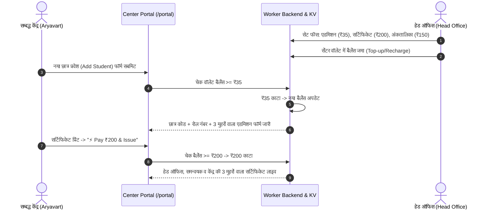

# 📘 Product Requirements Document (PRD) & System Architecture Manual
## Purvanchal Education and Skill Council (PESC) Platform
**Domain:** `pescouncil.in` | **System Version:** 2026 Enterprise Edition

---

## 1. Executive Summary (सिस्टम का परिचय)
**पूर्वांचल शिक्षा एवं कौशल परिषद (PESC)** एक आधुनिक, क्लाउड-नेटिव मल्टी-टेनेंट ऑटोनॉमस एजुकेशन मैनेजमेंट प्लेटफॉर्म है। यह भारतीय ट्रस्ट एक्ट, नीति आयोग (NGO Darpan) और ISO 9001:2015 मानकों के तहत संचालित सभी संबद्ध प्रशिक्षण केंद्रों (Affiliated Study Centres), क्षेत्रीय समन्वयकों (Regional Coordinators), काउंसिल हेड ऑफिस और लाखों छात्रों को एक केंद्रीकृत सर्वरलेस नेटवर्क से जोड़ता है।

---

## 2. Platform Architecture (सिस्टम की वास्तुकला)

### 2.1 सर्वरलेस टेक्नोलॉजी स्टैक:
- **Core Runtime:** Cloudflare Workers (Edge Serverless V8 Environment, जीरो लेटेंसी, 99.99% अपटाइम)।
- **Database / KV Persistence:** Cloudflare KV Namespace (`PESC_KV`) - विश्वभर में वितरित डेटा स्टोरेज।
- **Frontend Core:** Pure Semantic HTML5, CSS3 Glassmorphism UI, Native JavaScript (No heavy runtime bloatware)।
- **Security & Integrity:** Hashed Auth Tokens, Anti-Tamper Verification Hashes, Role-Based Access Control (RBAC)।

---

## 3. User Roles & Hierarchy (उपयोगकर्ता श्रेणियाँ व अधिकार)

| रोल (Role) | पोर्टल यूआरएल | मुख्य कार्य एवं शक्तियाँ |
| :--- | :--- | :--- |
| **1. Super Admin (हेड ऑफिस)** | `pescouncil.in/admin` | • पूरे भारत के सभी संबद्ध केंद्रों का प्रबंधन एवं नए केंद्र जोड़ना। • सेंटर वॉलेट में पैसे जोड़ना/काटना एवं लेनदेन हिस्ट्री देखना। • एडमिशन, सर्टिफिकेट एवं मार्कशीट की आधिकारिक फीस तय करना। • प्रमाणपत्रों पर हेड ऑफिस मुहर व डिजिटल हस्ताक्षर (S. N. Mishra) जारी करना। |
| **2. Regional Coordinator** | `pescouncil.in/coordinator` | • अपने मंडल/क्षेत्र के अंतर्गत आने वाले स्टडी सेंटर्स का निरीक्षण। • परीक्षा परिणामों व छात्रों के दस्तावेजों की द्वितीय-स्तरीय (Dual-Sign) स्वीकृति। • आधिकारिक समन्वयक मुहर व हस्ताक्षर (Er. V. K. Maurya) लगाना। |
| **3. Centre Director (स्टडी सेंटर)** | `pescouncil.in/portal` | • 17-मॉड्यूल का संपूर्ण इंस्टिट्यूट ERP सिस्टम। • नए छात्रों का प्रवेश (रजिस्ट्रेशन फीस स्वतः वॉलेट से कटती है)। • सर्टिफिकेट व मार्कशीट जारी करना (फीस कटौती उपरांत 3 मुहरों सहित)। • ID कार्ड, एडमिट कार्ड, फीस रसीद और वेबसाइट CMS कस्टमाइजेशन। |
| **4. Enrolled Student (छात्र)** | `pescouncil.in/student` | • अपने इनरोलमेंट नंबर/पासवर्ड से लॉगिन। • डिजिटल ID कार्ड, रिजल्ट, मार्कशीट व सर्टिफिकेट देखना व डाउनलोड करना। |
| **5. Public / Verifier (जनता/नियोक्ता)** | `pescouncil.in/verify` | • QR कोड स्कैन करके या रोल नंबर डालकर मार्कशीट/सर्टिफिकेट की 100% ऑनलाइन सत्यता जांचना। |

---

## 4. Wallet & Financial Deduction Engine (वॉलेट व कटौती प्रणाली)

सिस्टम का वित्तीय ढांचा **हेड-ऑफिस नियंत्रित प्री-पेड वॉलेट मॉडल** पर कार्य करता है:

### मुख्य नियम:
1. **हेड ऑफिस का पूर्ण नियंत्रण:** किसी भी केंद्र के वॉलेट में बैलेंस बढ़ाना, घटाना अथवा लॉक करना हेड ऑफिस एडमिन पैनल से होता है।
2. **पारदर्शी कटौती (Pre-issuance Deduction):** बिना वॉलेट में पर्याप्त बैलेंस के कोई भी केंद्र नया एडमिशन, सर्टिफिकेट या मार्कशीट जारी नहीं कर सकता।
3. **रियल-टाइम टॉपबार सिंक:** जैसे ही पैसे कटते हैं, टॉपबार में `topbarWalletAmount` स्वतः अपडेट हो जाता है।

---

## 5. 3-Stage Seal & Signature Workflow (त्रि-स्तरीय मुहर व हस्ताक्षर प्रक्रिया)

काउंसिल के सभी प्रमाणपत्र और अंकतालिकाएं **3-Stage Authentic Verification** के साथ जारी होती हैं:

1. **Stage 1 (Head Office Approval):**
   - पूर्वांचल शिक्षा एवं कौशल परिषद के केंद्रीय सचिव/अध्यक्ष (S. N. Mishra) की आधिकारिक नीली परिषद मुहर और डिजिटल हस्ताक्षर।
2. **Stage 2 (Regional Coordinator Approval):**
   - क्षेत्रीय समन्वयक (Er. V. K. Maurya) की बैंगनी मुहर और आधिकारिक हस्ताक्षर।
3. **Stage 3 (Centre Director Signing & Issuance):**
   - सेंटर डायरेक्टर (Dr. Ramesh Kumar - Aryavart) का हरा सेंटर सील और हस्ताक्षर, साथ ही सेंटर का वास्तविक पता जारी करने के स्थान (Place of Issue) के रूप में अंकित होना।

---

## 6. The 17 Centre ERP Modules (सेंटर पोर्टल के 17 मॉड्यूल)

1. **Dashboard & Students Management:** छात्रों की कुल संख्या, फीस वसूली, लंबित शुल्क और लाइव सर्च।
2. **Add Student (नया छात्र प्रवेश):** छात्र की व्यक्तिगत, पारिवारिक व शैक्षणिक जानकारी + फोटो अपलोड। सबमिट करते ही ₹35 वॉलेट कटौती मोडल और तुरंत 1-पेज A4 एडमिशन फॉर्म व रसीद।
3. **My Courses & Fee Setting:** विभिन्न डिप्लोमा व सर्टिफिकेट कोर्स (DCA, ADCA, CCC, PGDCA) की अवधि और सेंटर की अपनी ट्यूशन फीस प्रबंधन।
4. **Fees Collection & Receipts:** छात्रों से किश्तों में फीस लेना, पेंडिंग फीस ट्रैक करना और ऑटो-जनरेटेड फीस रसीद।
5. **Certificate Printing:** वार्षिक अथवा सेमेस्टर आधार पर सर्टिफिकेट का पूर्वावलोकन, ₹200 वॉलेट भुगतान एवं A4 हाई-डेफिनिशन प्रिंट/PDF।
6. **Marksheet Printing:** विषयवार थ्योरी व प्रैक्टिकल अंक, ग्रेडिंग (A+, A, Distinction) गणना, ₹150 वॉलेट भुगतान एवं आधिकारिक मार्कशीट।
7. **Cumulative Semester Certificate:** मल्टी-सेमेस्टर डिप्लोमा के संयुक्त अंक व अंतिम प्रमाणन।
8. **Mohar & Signature Management:** केंद्र का अपना सील व डायरेक्टर का हस्ताक्षर अपलोड करने की सुविधा।
9. **Student ID Card Generator:** फोटो, बारकोड और काउंसिल लोगो के साथ लेमिनेशन-रेडी आईडी कार्ड।
10. **Admit Card Generator:** परीक्षा सत्र के लिए रोल नंबर व विषय-तालिका युक्त प्रवेश पत्र।
11. **Payments & Wallet Ledger:** सेंटर का पूरा खाता-बही, ट्रांजेक्शन आईडी, क्रेडिट/डेबिट रिकॉर्ड।
12. **Online Examination Module:** छात्रों के ऑनलाइन टेस्ट और स्वतः मूल्यांकन।
13. **E-Learning & Course Materials:** छात्रों के लिए पीडीएफ नोट्स व स्टडी मटेरियल अपलोड।
14. **Affiliation Certificate:** काउंसिल द्वारा केंद्र को जारी संबद्धता प्रमाणपत्र (Franchise Certificate) डाउनलोड।
15. **Website CMS:** केंद्र के अपने पब्लिक सबडोमेन की हेडिंग, बैनर, फोटो गैलरी और संपर्क विवरण बदलना।
16. **Staff Management:** केंद्र के फैकल्टी व कंप्यूटर प्रशिक्षकों का विवरण।
17. **Support & Tickets:** हेड ऑफिस को त्वरित सहायता अथवा समस्या निवारण हेतु टिकट भेजना।

---

## 7. Multi-Tenant Subdomain Routing (सबडोमेन और वेबसाइट सिस्टम)

- प्रत्येक मान्यता प्राप्त केंद्र को उसका समर्पित वेब पता मिलता है (जैसे: `aryavart-institute-of-technology-management.pescouncil.in`)।
- यहाँ केंद्र की अपनी ब्रांडिंग, फोटो, उपलब्ध कोर्स, ऑनलाइन इन्क्वायरी फॉर्म और सेंटर का गूगल मैप लोकेशन दिखता है।
- बैकएंड वर्कर आने वाले HTTP Host हेडर का विश्लेषण करके उपयुक्त केंद्र की सामग्री रेंडर करता है।

---

## 8. Cryptographic QR Verification (सत्यापन प्रणाली)
प्रत्येक सर्टिफिकेट और मार्कशीट पर एक डायनामिक QR कोड होता है:
- **URL Format:** `https://pescouncil.in/verify/<ROLL_OR_TOKEN>`
- किसी भी स्मार्टफोन से स्कैन करने पर छात्र का नाम, कोर्स, पिता का नाम, प्राप्तांक और आधिकारिक मुहरें काउंसिल की वेबसाइट पर तुरंत प्रदर्शित हो जाती हैं।
